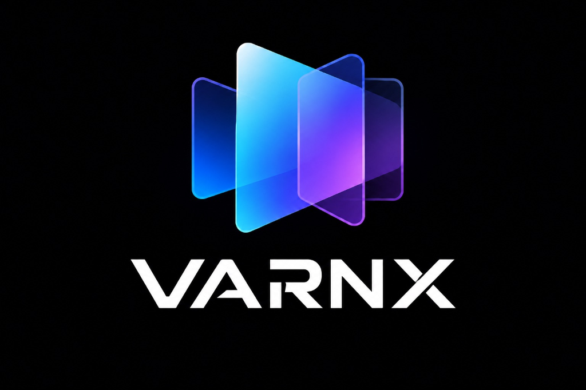
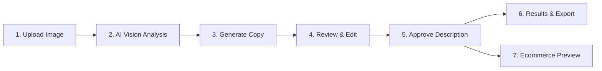

# VarnX — AI Product Description & Image Review Studio

<p align="center">
  
</p>

<p align="center">
  <strong>An Intelligent Human-in-the-Loop Review Platform for High-Converting, Accessible E-Commerce Catalogues</strong>
</p>

<p align="center">
  <a href="#-core-workflow"></a>
  <a href="#-features"></a>
  <a href="#-tech-stack"></a>
  <a href="#-ecommerce-preview"></a>
  <a href="#-license"></a>
</p>

---

## 📌 Executive Overview

**VarnX** is an editorial review studio built for digital commerce brands, marketplace sellers, and catalogue managers. It bridges the gap between raw computer vision outputs and buyer-ready, accessibility-compliant product listings. 

By pairing automated visual analysis with a disciplined human review workflow, VarnX ensures every published product description is:
- **Accurate & Observable**: Derived strictly from visible pixel details and verified merchant specifications.
- **High-Impact & Persuasive**: Crafted for maximum customer engagement, search discoverability, and conversion optimization.
- **Accessible (WCAG 2.2)**: Structured for screen readers, assistive technology, and multi-language e-commerce audiences.
- **Storefront-Ready**: Instantly previewable and exportable to major e-commerce platforms (Shopify, WooCommerce, Amazon, BigCommerce).

---

## 🔄 End-to-End Workflow



1. **Upload**: Drag-and-drop single images or batch upload up to 20 images at once with real-time numeric progress indicators and automatic price estimation.
2. **AI Vision Analysis**: Evaluates image clarity, blur, contrast, resolution, and detects observable visual attributes and category taxonomy.
3. **Generate Copy**: Creates detailed, comprehensive product copy including bulleted highlights, short summaries, and high-impact marketplace descriptions.
4. **Human Review & Edit**: Real-time editor with diff view, text-to-speech audio verification, language switcher, and conversion metrics.
5. **Approve**: 1-Click editorial sign-off creating an immutable audit trail entry and syncing with backend persistence.
6. **Results**: Catalogue management table with search/filtering, selection checkboxes, and formula-injection-safe CSV / JSON exports.
7. **Ecommerce Preview**: Dedicated storefront listing card with approved content lock, verified image viewer, and configurable live store URL launcher.

---

## ✨ Key Features

### 🛍️ Marketing & Ecommerce Storefront Preview
- **Live Product Listing View**: Presents the product exactly as it will appear to shoppers on a modern storefront.
- **Approved-Content Guard**: Strictly locks display to final approved descriptions—unapproved drafts are never displayed on the public preview.
- **Configurable Store URL**: Enter destination URLs (Shopify, WooCommerce, Amazon, custom domains) with a 1-click **"View on Ecommerce Store ↗"** launcher.
- **Factual Highlights**: Displays confirmed observable features and specifications without speculative AI claims.

### ⚡ Batch & Multi-Image Ingestion
- Upload up to **20 high-resolution images** in a single batch.
- Live percentage progress bar, concurrent queue processing, and automatic deterministic price estimation based on category and image keywords.
- Instant queue population: newly uploaded items are immediately accessible in the Review Studio.

### ✍️ Review Studio & Editorial Engine
- **Expanded Editorial Canvas**: Designed with comfortable line-height, live character/word counters, and conversion-readiness indicators.
- **"✨ Make Detailed & High-Impact"**: Enhances sparse copy into rich, multi-paragraph, buyer-oriented editorial descriptions.
- **Text-to-Speech Audio Preview**: Listen aloud to descriptions using native browser speech synthesis.
- **Version Diffing**: Inspect differences between raw AI suggestions and human-edited revisions.
- **Multi-Language Support**: High-visibility popover language switcher supporting English, Hindi, and Telugu descriptions.

### 📊 Results & Export Studio
- **Export Formats**: Standard CSV with UTF-8 BOM (`utf-8-sig`) for Excel/Sheets compatibility, plus structured JSON catalogues.
- **Formula Injection Defense**: Automatically neutralizes formula injection vectors (`=`, `+`, `-`, `@`) upon export.
- **Selective Batch Export**: Download specific items or export the entire reviewed catalogue with one click.

---

## 🛠️ Architecture & Tech Stack

```
Product-Image-Description-Review-Tool/
├── backend/
│   ├── app/
│   │   ├── main.py            # FastAPI endpoints & CORS configuration
│   │   ├── models.py          # Pydantic schemas & state models
│   │   ├── database.py        # SQLite / review state persistence engine
│   │   └── services/          # Vision analysis & rule validation services
│   └── requirements.txt       # Python dependencies
├── frontend/
│   ├── src/
│   │   ├── App.jsx            # Main workspace router & state coordinator
│   │   ├── App.css            # VarnX design system styling
│   │   ├── components/
│   │   │   ├── preview/       # EcommercePreviewPage component
│   │   │   ├── workspace/     # Review Studio, BatchView, Editor
│   │   │   ├── landing/       # HomeLandingPage
│   │   │   └── auth/          # Authentication & Onboarding modals
│   │   └── main.tsx           # React entry point
│   ├── public/
│   │   └── varnx-logo.png     # Official VarnX branding asset
│   └── package.json           # Frontend dependencies & build scripts
└── README.md
```

| Layer | Technologies |
|---|---|
| **Frontend Framework** | React 19, Vite, TypeScript, JavaScript (ES2024) |
| **Styling & UI** | CSS3 Design Tokens, Glassmorphism, Responsive Grid / Flexbox |
| **Backend API** | Python 3.11+, FastAPI, Uvicorn, Pydantic v2 |
| **Persistence** | SQLite with atomic review state fallback |
| **Build & Quality** | Vitest, TypeScript compiler (`tsc -b`), ESLint |

---

## 🚀 Quickstart Guide

### Prerequisites
- **Node.js** 18.0 or higher
- **Python** 3.10 or higher
- **Git**

### 1. Clone the Repository
```bash
git clone https://github.com/TumukuntaSrivalli/Product-Image-Description-Review-Tool.git
cd Product-Image-Description-Review-Tool
```

### 2. Backend Setup
```bash
cd backend
python -m venv venv
# Windows:
.\venv\Scripts\activate
# Linux/macOS:
source venv/bin/activate

pip install -r requirements.txt
python -m uvicorn app.main:app --reload --host 127.0.0.1 --port 8000
```
- API Base: `http://127.0.0.1:8000`
- Interactive Swagger Documentation: `http://127.0.0.1:8000/docs`

### 3. Frontend Setup
In a new terminal window:
```bash
cd frontend
npm install
npm run dev
```
- Application URL: `http://localhost:5173`
- The Vite dev server automatically proxies API requests to `http://127.0.0.1:8000`.

---

## ⌨️ Universal Keyboard Shortcuts

VarnX features high-velocity navigation shortcuts for review operators:

| Key | Action |
|:---:|---|
| <kbd>J</kbd> / <kbd>K</kbd> | Navigate to Next / Previous Product in queue |
| <kbd>A</kbd> | Approve Current Description |
| <kbd>E</kbd> | Focus Description Textarea for Editing |
| <kbd>F</kbd> | Flag Item as Inaccessible |
| <kbd>D</kbd> | Toggle Decorative Image status (`alt=""`) |
| <kbd>T</kbd> | Toggle Light ("Paper") / Midnight Theme |
| <kbd>⌘</kbd> + <kbd>K</kbd> / <kbd>Ctrl</kbd> + <kbd>K</kbd> | Open Universal Command Palette |
| <kbd>?</kbd> | Open Keyboard Shortcuts Cheatsheet |

---

## 🔒 Editorial Standards & Compliance Notice

> [!NOTE]
> **Human-in-the-Loop Requirement**: While VarnX leverages generative vision models to expedite drafting, human editorial verification remains mandatory. Alternative text alone addresses WCAG 2.2 Success Criterion 1.1.1 (Non-text Content); comprehensive digital accessibility requires full site auditing including keyboard navigation, color contrast, and screen reader testing.

---

## 📄 License

This project is licensed under the [MIT License](LICENSE).
